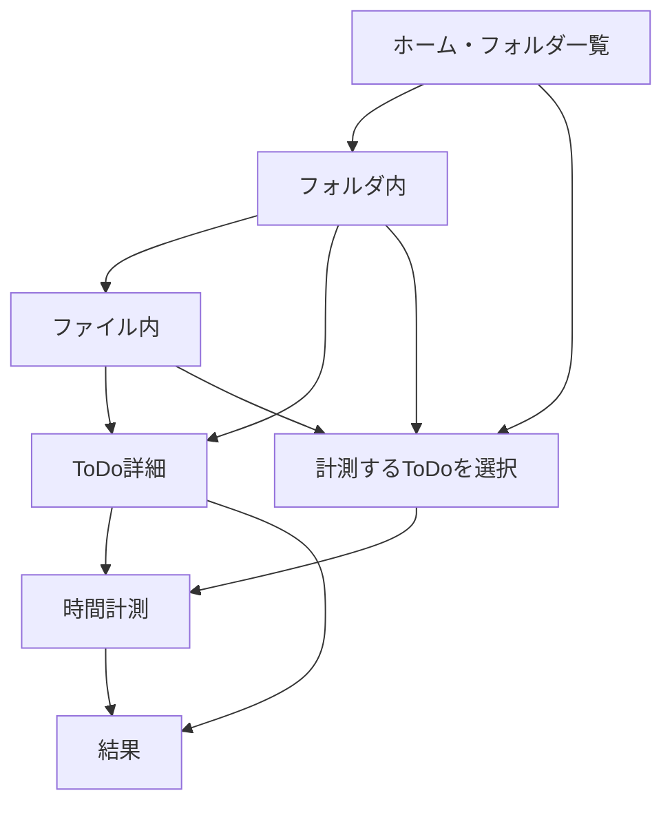

# 読んで判断できる設計書 v0.1

## アプリの仕組み

フォルダは大きな箱、ファイルはその中の小さな箱、ToDoは実際に取り組むことです。画面設計v0.3に合わせて、フォルダ直下にもToDoを置けます。ファイルを作らなくても使えるためです。ただし要件定義書での採否は未確認です。

下部の結果は、開いている箱やToDoの範囲を引き継ぎます。ホームの結果は全体。一覧はToDoの所属先に戻り、ホームは常にフォルダ一覧に戻ります。戻るはアプリ内で直前に開いた画面です。ブラウザ標準の戻ると画面履歴の連動は未実装です。

## 画面定義（実装した範囲）

|原資料ID|画面|表示と操作|空・失敗時|
|---|---|---|---|
|S01|ホーム|2列フォルダ、作成、全件一覧、バックアップ|0件なら最初の作成を案内|
|S02|フォルダ内|直下ToDoとファイルを分離、各追加・名称編集|未完了0件を表示|
|S03|ファイル内|優先度順、期限順、作成順、検索、完了表示切替|予定なしの期限は末尾|
|S09|ToDo詳細|名前、優先度、予定、期限、メモ、実績、開始・結果・編集|予定なしは未設定。完了済みは開始不可（暫定）|
|S10|計測対象選択|現在の範囲の未完了ToDo、検索、1件選択して開始|未選択では開始不可|
|S04|時間計測|経過時間、停止、再開、記録、結果|実行中は記録不可。方式はストップウォッチのみ|
|S05〜08|結果|対応範囲の完了率・件数・優先度別棒・予定比較・記録|0件は0%・データなし|
|D01〜03|作成・編集|名前、ToDoのみ予定分・期限・優先度・メモ|エラー表示、入力を保持|
|D04相当|表示設定|一覧に直接配置、全体で共通保存|完了非表示でも集計対象に含める|

S05〜08は共通の画面部品で対象だけを変えます。フォルダ・ファイル内訳から各結果へ移動できます。元PDFの全グラフやD05・D07の再現は未実装です。

## 入力と保存

|項目|規則|初期値|
|---|---|---|
|フォルダ・ファイル名|前後空白を除き1〜50文字|空|
|ToDo名|前後空白を除き1〜100文字|空|
|優先度|赤・オレンジ・黄色・緑から1つ|緑|
|予定時間|空または整数1〜59999分|未設定|
|期限|日付、任意|未設定|
|メモ|500文字以内|空|

重複名は暫定で許可。予定0分は未設定と区別できないため受け付けない。上限は試作用で要確認。時間・分の2欄ではなく総分数1欄にした。文字数チェックとエラーを保存処理にも置く。保存前に成功表示しない。保存失敗時は元データを維持し、フォーム・停止時間を残す。

フォームをキャンセルすると、変更があれば保存／破棄／継続を表示。編集中は背景画面の操作を止めるため、PDFの「編集中に下部ナビで移動」はまだできない。閉じてから移動する。タブを閉じるときにはブラウザ標準の警告を要求するが、端末によって警告されないことがある。

## 計測の約束

1. 一度に1件。選択だけでは開始しない。
2. 開始日時と計測状態を直ちに端末保存する。
3. 停止で経過時間を確定し、再開では停止中の時間を含めない。
4. 記録ボタンでのみ作業記録へ追加する。ToDoの完了にはしない。
5. 1秒未満は記録せず、時間を保持する。
6. 保存成功後に計測状態を空にする。1つの計測には同じ識別番号を使い二重記録を防ぐ。
7. 別ToDoを押しても既存計測を優先し、勝手に切り替えない。破棄・切替操作は未実装。

ページ移動・再読込・ブラウザを閉じた時間も、計測中なら経過に含める（仮定）。端末時計の変更やスリープの実機検証は未実施。時計を過去に戻した場合は負数にしないが、厳密な補正はない。停止中の作業記録の終了日時は記録ボタンを押した日時となり、開始〜終了の幅には休憩も含む。計測時間自体は休憩を除く。

## 結果の計算

- 完了率＝現在完了の件数÷現在の総件数。0件は0%。小数は整数に四捨五入。
- 累計実績＝対象ToDoの保存済みミリ秒合計。画面では分の小数1桁に丸める。
- 予定比較は「予定あり」の同じToDoだけを両側で集計。差分＝実績−予定。未完了は途中実績と説明する。
- 今日／今月／今年／全期間は作業記録だけの絞り込み。端末の地域時刻・記録終了日時で判定。日跨ぎを日別に分割しない（仮定）。累計と期間合計を混同しない表示にする。
- フォルダ直下とファイル内ToDoは、1件ずつ重複なく数える。
- 完了率は期間別の達成率ではない。過去時点の完了率・日／月／年グラフ・期限との比較・作業日数は未実装。

## 構成と安全対策

`app.js`は画面・操作、`domain.js`は計測・集計・入力規則、`style.css`は見た目、`server.mjs`はローカル配信を担当。外部へのデータ送信はしない。サーバーは端末自身だけに接続を限定し、公開用には使わない。

利用者が入力した文字はHTMLとして実行させず文字として表示する。外部スクリプト・通信をブラウザの制限設定でも禁止する。保存データの読込に失敗した場合は編集を止め、元の保存データを上書きしない。別タブの変更を検知したら再読込を求める。同時に保存する競合への完全な排他制御はないため、1タブで利用する。

認証・利用者間の隔離・暗号化・バックアップ復元は未実装。複数人の共有端末や本番サービスにはこのまま利用しない。
