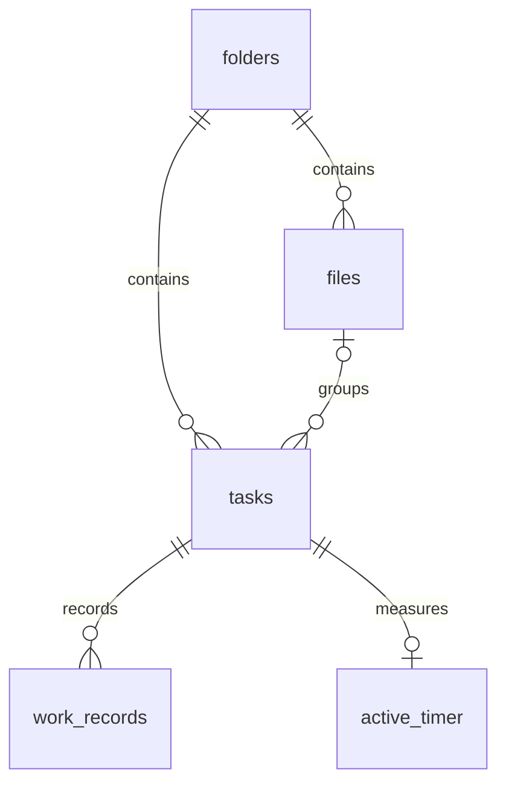

# データベース設計案 v0.1

本書は論理設計（何をどう関連付けて保存するか）。本番DB製品は未決定。添付 `schema-sqlite.sql` は端末内保存候補のSQLiteで実行検証したたたき台。試作アプリの保存先はlocalStorageであり、このSQLにはまだ接続していない。

## 保存する情報

|表|保存項目と規則|意味|
|---|---|---|
|folders|id、name（1〜50文字）、created_at|大きな箱|
|files|id、folder_id、name（1〜50）、created_at|フォルダに属する小さな箱|
|tasks|id、folder_id、file_id（任意）、name（1〜100）、priority（0〜3）、planned_minutes（任意・1〜59999）、due_date（任意）、memo（500以内）、done、created_at、completed_at|ToDo。file_idなしなら直下|
|work_records|id、task_id、duration_ms（1000以上）、started_at、ended_at、memo|1回の保存済み作業|
|active_timer|slot（常に1）、id、task_id、elapsed_ms、started_at（停止中は空）、first_started_at|途中の計測。最大1件|
|settings|id（常に1）、sort_order、show_done|表示設定|

IDは重複しない文字列（UUID）。時刻はUTC基準の経過ミリ秒、期限は時刻を持たないYYYY-MM-DD。画面上は端末の地域時刻で表示。予定未入力はNULL（値なし）とし、0分と混同しない。作業時間は表示用に丸めず保存する。

## データ保護と更新

ファイルは必ず1つのフォルダに属する。ToDoのfolder_idとfileのfolder_idが一致するよう複合外部キー（関連先の組合せを保証する仕組み）を設定。作業記録は必ず存在するToDoに属する。

削除はRESTRICT（関連データがあれば拒否）を初期方針とする。配下を一括削除するSQLは用意していない。履歴を残すか、論理削除（非表示にするだけ）を使うかは要確認。試作UIの削除は未実装。

記録保存時は「作業記録追加」と「途中計測削除」を1つのトランザクション（全部成功か全部取消にする操作）で行う。同じ計測IDで記録を再送しても追加は1回。既存IDの場合は内容が一致することも検証し、競合はエラーにする。本番実装時に検証が必要。

作成・完了の日時は保持する。完了解除したらcompleted_atを空にする。これだけでは過去の完了切替履歴は復元できない。過去時点の達成率が必要なら履歴表を追加する判断が必要。

繰り返し・手入力の表は、例外ルールが未決定のため追加していない。予定時間の編集は累計比較にも影響する。過去の予定を固定するなら予定履歴が必要。

## MySQLを選ぶ場合

- idをCHAR(36)、長い本文はVARCHAR、時刻をBIGINT、予定はINT、状態はBOOLEAN相当で定義する。
- utf8mb4文字コードを指定する。CHECK制約が有効なMySQLのバージョンを選ぶ。
- インデックス：files(folder_id)、tasks(folder_id,file_id,done,priority)、work_records(task_id,ended_at)。SQLite案にも関連索引を置く。
- 利用者ごとに共有するサービスならusers表とowner_idを追加する。すべての検索・更新・集計を認証済み本人の範囲に限定し、他人のIDを指定しても閲覧・変更できないテストを実装する。
- スマホ内SQLiteとサーバーMySQLの両方を持つと同期競合が増えるため、最初から両方導入する前に必要性を確認する。
- SQLite案をそのままMySQLへ投入しない。MySQL／MariaDBの実環境で制約・日本語・時刻・トランザクションを検証する。今回は未実施。

## 端末保存からの移行

localStorageのversion=1を読み取る → 値と関連先を検査 → 一時DBへ全件登録 → 件数・時間合計を比較 → 成功確認後に切替。元データを直ちに消さずバックアップを保持する。移行プログラム・復元プログラムは未実装。実データ削除・外部送信には企画責任者の確認が必要。
